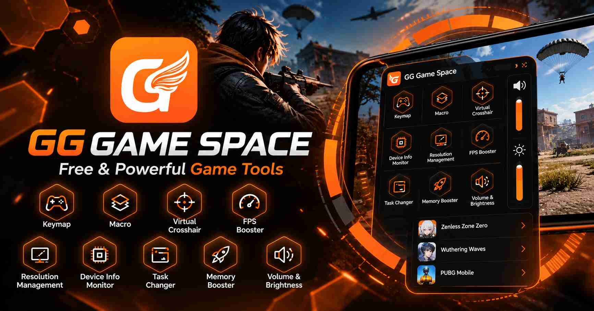

<p align="center">
  
</p>

# GG Game Space

Official website for **GG Game Space**, an Android game-tools app. Browse the app's features, setup guidance, compatibility notes, FAQs, and official Google Play download.

**Website:** [gggame.space](https://www.gggame.space/) · **Google Play:** [GG Game Space](https://play.google.com/store/apps/details?id=com.zjx.gamebox)

## Website preview

The image above is also configured as the website's Open Graph image (`og:image`) for social link previews.

## Website pages

- [Home](https://www.gggame.space/)
- [Features](https://www.gggame.space/features)
- [Getting Started](https://www.gggame.space/getting-started)
- [Compatibility](https://www.gggame.space/compatibility)
- [FAQ](https://www.gggame.space/faq)
- [Download](https://www.gggame.space/download)
- [Contact & Support](https://www.gggame.space/contact)
- [Privacy Information](https://www.gggame.space/privacy)
- [Website Terms](https://www.gggame.space/terms)

## Project structure

```text
.
├── assets/
│   ├── css/style.css
│   ├── img/                 # App screenshots, icons, and social preview
│   └── js/
│       ├── config.js        # Shared app links and product details
│       └── main.js          # Navigation and shared page behavior
├── index.html
├── features.html
├── getting-started.html
├── compatibility.html
├── faq.html
├── download.html
├── contact.html
├── privacy.html
├── terms.html
├── robots.txt
├── sitemap.xml
└── vercel.json
```

## Run locally

This is a static HTML, CSS, and JavaScript website; no package installation or build step is required.

1. Clone or download this repository.
2. Start a local static server from the project directory, for example:

   ```powershell
   python -m http.server 8000
   ```

3. Open `http://localhost:8000/` for the homepage. In a basic Python server, open subpages with their `.html` filenames (for example, `/features.html`). The deployed Vercel site uses clean URLs such as `/features`.

## Deployment and SEO

- The site is configured for Vercel in [`vercel.json`](vercel.json), including clean URLs and the `gggame.space` to `www.gggame.space` redirect.
- Crawlers are allowed in [`robots.txt`](robots.txt); the sitemap is at [`sitemap.xml`](sitemap.xml).
- The homepage defines canonical, Open Graph, Twitter card, and structured application metadata.
- Search indexing and ranking are determined by search engines and are not guaranteed by these files alone.

## Product information

Product details shown on the website are maintained in [`assets/js/config.js`](assets/js/config.js). Keep store links, requirements, and contact details accurate and verified when updating them. Feature availability can vary by game and device; the website does not guarantee compatibility or performance results.

## Contact

Use the [GG Game Space contact page](https://www.gggame.space/contact) for support and community links.
